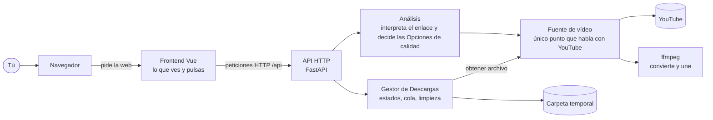
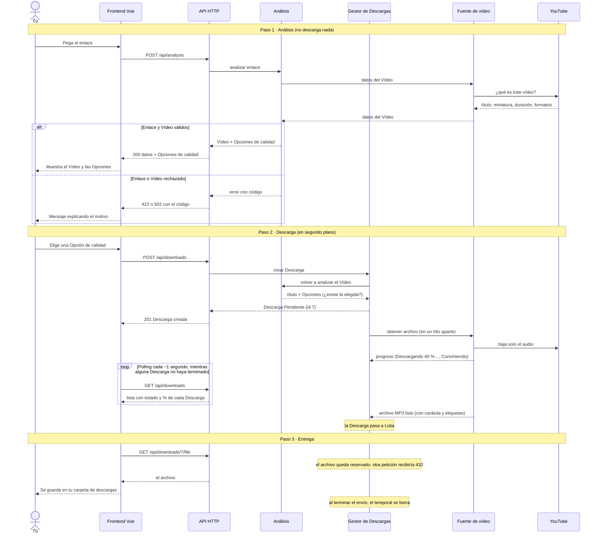
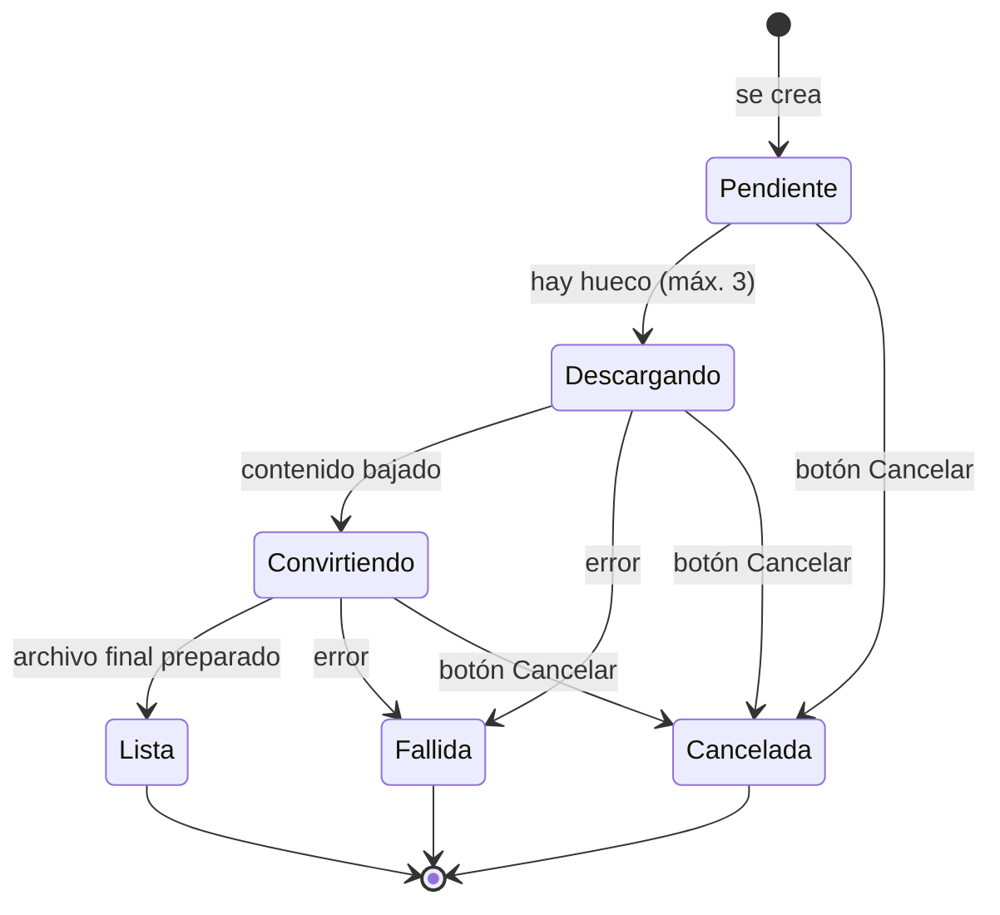
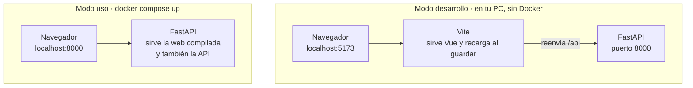
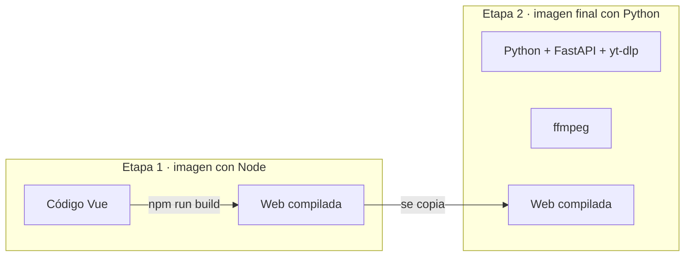
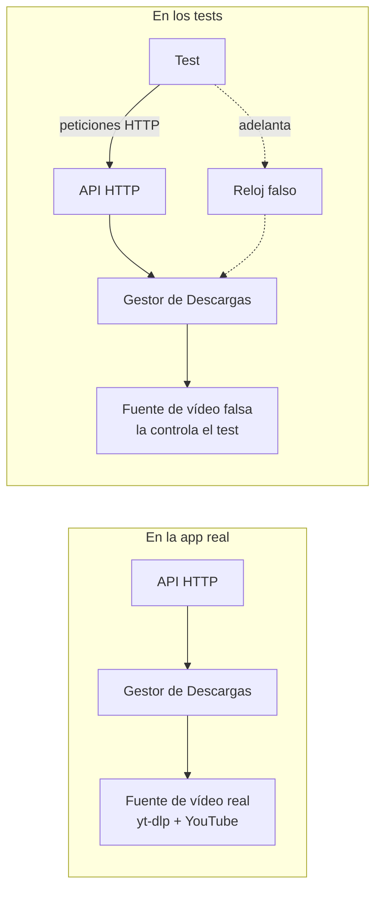
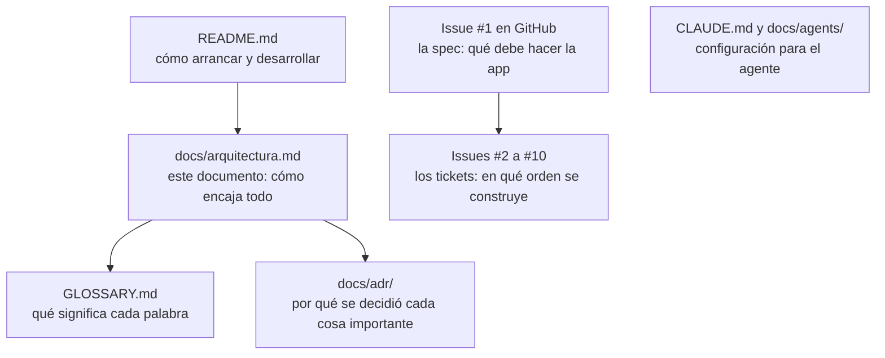

# Arquitectura de DownloadYTLocalWeb

Guía visual de cómo está construida la app, pensada para quien empieza. Si un término en **negrita** no te suena, búscalo en el [glosario](../GLOSSARY.md).

> **Estado:** diseño acordado, implementación en curso. Cada sección indica qué tickets la hacen realidad. Este documento se actualiza junto con el código.

---

## 1. Vista general: las piezas

La app se divide en piezas con una responsabilidad cada una. Cada pieza solo habla con la de al lado.

| Pieza | Qué hace | Qué NO hace |
|---|---|---|
| **Frontend Vue** | Muestra el formulario, las Opciones de calidad y la lista de Descargas. Pregunta a la API cada segundo cómo van. | No sabe nada de YouTube ni de ffmpeg. |
| **API HTTP** | Recibe las peticiones del navegador y las traduce en llamadas a las otras piezas. Es una capa fina. | No contiene lógica de negocio. |
| **Análisis** | Interpreta el enlace pegado, pide los datos del Vídeo a la Fuente de vídeo y decide qué Opciones de calidad ofrecer (y cuál va preseleccionada). | No habla con YouTube directamente. |
| **Gestor de Descargas** | El cerebro: crea Descargas, controla sus estados, limita a 3 en paralelo, cancela, reintenta y borra temporales. | No sabe cómo se baja un vídeo; se lo pide a la Fuente de vídeo. |
| **Fuente de vídeo** | Envuelve yt-dlp y ffmpeg. Consulta los datos de un Vídeo y obtiene el archivo final. | No sabe qué es una Descarga, ni sus estados, ni qué Opciones de calidad se ofrecen. |

**¿Por qué el Análisis no está dentro de la Fuente de vídeo?** Porque interpretar el enlace y decidir las Opciones de calidad son reglas de *esta* app, no de YouTube. Así, en los tests (que sustituyen la Fuente de vídeo por una falsa) esas reglas siguen probándose.

**¿Por qué separar así?** Porque YouTube cambia a menudo y yt-dlp se rompe. Si todo lo que toca YouTube vive en una sola pieza (la Fuente de vídeo), los arreglos quedan ahí y el resto no se entera. Además, en los tests se cambia la Fuente de vídeo por una **falsa** que no usa internet, y así se prueba todo lo demás en milisegundos (ver sección 6).

---

## 2. Recorrido completo: de pegar un enlace a tener el archivo

Un diagrama de secuencia se lee de arriba abajo: cada flecha es un mensaje entre piezas, en orden temporal.

**Rechazos del Análisis.** Cada motivo tiene un código que la web traduce a un mensaje en español:

| Código | Quién lo detecta | Cuándo |
|---|---|---|
| `unsupported_link` | Análisis | El enlace no es de un Vídeo de YouTube. |
| `playlist_not_supported` | Análisis | El enlace es de una Lista de reproducción sin Vídeo concreto. |
| `live_not_supported` | Fuente de vídeo | Directo en curso o estreno que aún no ha empezado. |
| `video_unavailable` | Fuente de vídeo | Privado, eliminado, con restricción de edad, bloqueado en tu país… |
| `source_failed` (HTTP 502) | Fuente de vídeo | Falla YouTube o yt-dlp, no el Vídeo: sin conexión o yt-dlp desactualizado. |

Los cuatro primeros responden 422 (el problema es lo que se pidió); `source_failed` responde 502 (el problema está en un servicio del que dependemos).

**Errores de Descarga.** Siguen el mismo formato `{"code": …}`:

| Código | HTTP | Cuándo |
|---|---|---|
| `unknown_quality_option` | 422 | La Opción de calidad elegida no existe para ese Vídeo. |
| `download_not_found` | 404 | No hay ninguna Descarga con ese número (p. ej. tras reiniciar la app). |
| `download_not_ready` | 409 | Se pide el archivo de una Descarga que aún no está Lista. |
| `file_already_collected` | 410 | El archivo ya se entregó (y se borró del servidor). |
| `download_not_cancellable` | 409 | Se intenta cancelar una Descarga que ya terminó (Lista, Fallida o Cancelada). |

**Varios hilos a la vez.** Cada Descarga se ejecuta en un hilo aparte mientras otros hilos atienden las peticiones del navegador. Para que no se pisen, cada Descarga solo cambia a través de sus propios métodos, protegidos con un *lock* (un candado que solo un hilo puede tener a la vez), y hacia fuera se entregan copias coherentes. Por eso, por ejemplo, si llegan dos peticiones del archivo a la vez, solo la primera lo recibe.

**Idea clave:** la petición del paso 2 responde **al instante** ("Descarga creada"), aunque la Descarga tarde minutos. El trabajo real sigue en segundo plano y el navegador pregunta periódicamente cómo va (**polling**). Ver [ADR 0001](adr/0001-descarga-como-trabajo-en-memoria-con-polling.md) para el porqué.

---

## 3. Los estados de una Descarga

Una **máquina de estados** describe en qué situaciones puede estar algo y qué caminos hay entre ellas. Una Descarga solo avanza: nunca vuelve atrás.

- **Lista, Fallida y Cancelada** son estados **terminales**: ya no cambian.
- **Reintentar** no "resucita" una Descarga Fallida o Cancelada: crea una **Descarga nueva** con el mismo Vídeo y la misma Opción de calidad. Así cada Descarga tiene una historia simple y lineal.
- Cuando una Descarga deja de trabajar (llega a Lista o Fallida, o aborta tras cancelarla), libera su hueco y la Pendiente más antigua arranca.
- **Cancelar** (`POST /api/downloads/{id}/cancel`) la deja Cancelada al momento:
  - si estaba **Pendiente**, cuando le toque el turno el hilo se la salta sin descargar nada;
  - si estaba **en curso**, la Fuente de vídeo pregunta "¿me han cancelado?" (`is_cancelled()`) antes de empezar y en cada aviso de progreso de yt-dlp, y aborta;
  - **la conversión de ffmpeg no se puede cortar a medias**: si se cancela mientras convierte, la Descarga aparece Cancelada al momento, pero su hilo termina ese paso, descarta el resultado y solo entonces libera el hueco. Convertir una canción tarda unos segundos (y unir un MP4 es casi instantáneo, porque no recomprime); solo en sesiones de horas se nota la espera;
  - en todos los casos se borran los archivos parciales.
- Por dentro, el Gestor de Descargas tiene un grupo fijo de 3 hilos trabajadores con una cola por orden de llegada. En cuanto un hilo coge una Descarga, esta pasa a Descargando, aunque todavía no se sepa el porcentaje: Pendiente significa solo "esperando turno".

---

## 4. Dos formas de arrancar la app: desarrollo y uso

Vue hay que **compilarlo** (convertirlo en HTML, JS y CSS que el navegador entiende). Por eso hay dos modos.

| | Desarrollo | Uso |
|---|---|---|
| Programas en marcha | 2 (Vite + FastAPI) | 1 (FastAPI dentro de Docker) |
| Necesitas instalado | Python, Node, ffmpeg | Solo Docker |
| Cambios en el código | Se ven al instante | Hay que reconstruir la imagen |
| Accesible desde | Tu PC | Solo tu PC (`127.0.0.1`) |

Ver [ADR 0002](adr/0002-docker-para-uso-desarrollo-nativo.md).

### Cómo se construye la imagen Docker

La imagen final no lleva Node: solo hacía falta para compilar. Así es más pequeña.

---

## 5. Versiones fijadas (y la excepción de yt-dlp)

Todas las versiones (Python, librerías, Vue…) están **fijadas** a un número exacto, para que la app funcione igual en cualquier PC. yt-dlp también, pero como YouTube cambia a menudo, hay un comando documentado para actualizarlo en un paso cuando deje de funcionar. Ver [ADR 0003](adr/0003-yt-dlp-fijado-con-actualizacion-en-un-paso.md).

---

## 6. Cómo se prueba

Los tests entran por **un único punto** (el *seam*): la API HTTP, exactamente igual que el navegador. La única pieza que se sustituye es la Fuente de vídeo.

- La **Fuente falsa** puede responder al momento, quedarse "atascada" hasta que el test la libere, o fallar a propósito. Así se prueban la cola, la cancelación o los errores sin internet.
- El **reloj falso** permite probar "se borra tras 1 hora" sin esperar una hora.
- Los tests solo miran lo que se ve desde fuera (respuestas de la API, archivos que existen o no), nunca el interior del código. Así, si se reorganiza el código por dentro, los tests siguen sirviendo.

---

## 7. Mapa de la documentación

| Si te preguntas… | Mira |
|---|---|
| ¿Qué significa "Análisis" o "Descarga"? | [GLOSSARY.md](../GLOSSARY.md) |
| ¿Por qué no hay base de datos? ¿Por qué Docker? | [docs/adr/](adr/) |
| ¿Qué tiene que hacer exactamente la app? | [Issue #1](https://github.com/Kokon4/DonwloadYTLocalWeb/issues/1) |
| ¿Qué falta por construir? | [Issues abiertos](https://github.com/Kokon4/DonwloadYTLocalWeb/issues) |
| ¿Cómo encaja todo? | Este documento |

---

## Avance por tickets

| Sección | Tickets |
|---|---|
| 1 · Piezas: Frontend, API, Análisis, Fuente de vídeo | #2 (esqueleto) ✅, #3 (rechazos) ✅ |
| 2 · Recorrido completo y Gestor de Descargas | #4 (primera Descarga MP3) ✅, #5 (MP4) ✅ |
| 3 · Estados: cola, cancelar, reintentar | #6 ✅, #7 ✅, #8 |
| 3 · Limpieza y caducidad | #9 |
| 4 · Docker y modo uso | #10 |
